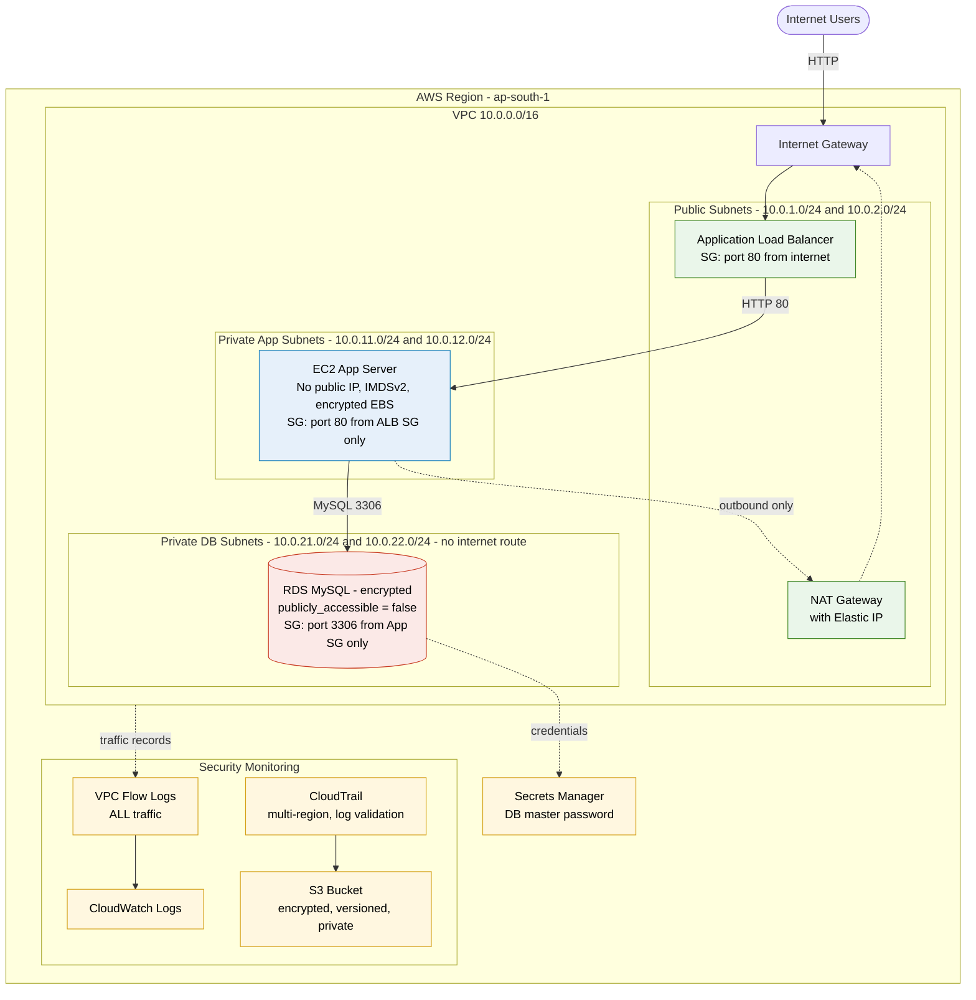

# Secure Three-Tier Application on AWS using Terraform

Cloud Security – Capstone Project (Assignment 5)

A secure, scalable three-tier architecture (**Web/ALB → Application/EC2 → Database/RDS**) provisioned entirely as code with Terraform, following AWS security best practices, with VPC Flow Logs and CloudTrail for security monitoring.

## Architecture Diagram



> A PNG version of this diagram is also included: [`architecture-diagram.png`](architecture-diagram.png).


## Assignment Requirements → Where They Are Implemented

| # | Requirement | Implemented in |
|---|---|---|
| 1 | VPC with public and private subnets | `vpc.tf` (2 public, 2 private-app, 2 private-db across 2 AZs) |
| 2 | Application Load Balancer in public subnets | `alb.tf` |
| 3 | EC2 application server in private app subnet | `ec2.tf` |
| 4 | RDS database in private database subnet | `rds.tf` |
| 5 | Internet Gateway, NAT Gateway, route tables, security groups | `vpc.tf`, `security_groups.tf` |
| 6 | DB not public, accepts connections only from app server | `rds.tf` (`publicly_accessible = false`), `security_groups.tf` (DB SG allows 3306 only from App SG) |
| 7 | Security monitoring: VPC Flow Logs + CloudTrail | `monitoring.tf` |
| 8 | Terraform code, diagram, screenshots | This repo (`*.tf`, `architecture-diagram.png`, `screenshots/`) |

## Security Design Highlights

- **Network segmentation:** three isolated subnet tiers. The DB route table has **no internet route at all**.
- **Least-privilege security groups:** Internet → ALB (80) → App (80, from ALB SG only) → DB (3306, from App SG only). The DB security group has no outbound rules.
- **No public IP on app server or DB.** Outbound-only internet for the app tier goes through the NAT Gateway.
- **No SSH / no key pair / no port 22.** Admin access is via AWS Systems Manager Session Manager.
- **IMDSv2 enforced** on EC2; **encrypted EBS** root volume.
- **RDS storage encrypted**; master password is **auto-generated and stored in AWS Secrets Manager** (never in code or Terraform state).
- **Default security group locked down** (no rules).
- **VPC Flow Logs** (ALL traffic, accepted + rejected) → CloudWatch Logs.
- **CloudTrail** (multi-region, log file validation) → private, versioned, encrypted S3 bucket with public access blocked and TLS-only policy.

## Prerequisites

- AWS account and an IAM user/role with permissions to create the resources above
- [Terraform](https://developer.hashicorp.com/terraform/install) >= 1.5
- [AWS CLI](https://docs.aws.amazon.com/cli/latest/userguide/getting-started-install.html) configured (`aws configure`)

## Deploy

```bash
git clone <your-repo-url>
cd <repo-folder>

terraform init
terraform fmt
terraform validate
terraform plan
terraform apply
```

After `apply` (about 10–15 minutes, RDS is the slowest), Terraform prints `alb_dns_name`. Open it in a browser; allow 1–2 minutes after apply for the target to become healthy.

Default region is `ap-south-1`. To change it, copy `terraform.tfvars.example` to `terraform.tfvars` and edit.

## Verify the Security Configuration

```bash
# App server has NO public IP (expect null / None)
aws ec2 describe-instances --instance-ids $(terraform output -raw app_server_instance_id) \
  --query "Reservations[].Instances[].PublicIpAddress"

# Database is NOT publicly accessible (expect false)
aws rds describe-db-instances --db-instance-identifier secure-3tier-db \
  --query "DBInstances[].PubliclyAccessible"

# Fetch the generated DB password from Secrets Manager
aws secretsmanager get-secret-value --secret-id $(terraform output -raw db_secret_arn) \
  --query SecretString --output text

# Connect to the app server with SSM (or EC2 Console > Connect > Session Manager)
aws ssm start-session --target $(terraform output -raw app_server_instance_id)

# From inside the app server: DB is reachable ONLY from here
mysql -h <rds_endpoint> -u dbadmin -p
```

Flow logs: CloudWatch Console → Log groups → `/aws/vpc/secure-3tier-flow-logs`.
CloudTrail: CloudTrail Console → Event history, and the S3 bucket named in `cloudtrail_bucket` (log delivery can take ~5–15 minutes).

See [`screenshots/README.md`](screenshots/README.md) for the full screenshot checklist.

## Clean Up (Important – avoids charges)

```bash
terraform destroy
```

The NAT Gateway and RDS instance cost money while running. Destroy the stack when you have finished capturing screenshots.

## Design Decisions and Limitations

- **Single NAT Gateway** and **single-AZ RDS / one app instance** to keep lab cost low. For production: one NAT per AZ, `multi_az = true`, and an Auto Scaling Group for the app tier.
- **HTTP listener only.** HTTPS would require an ACM certificate and a registered domain; production should redirect 80 → 443.
- **Lab-friendly teardown settings** (`skip_final_snapshot = true`, `deletion_protection = false`, `force_destroy = true` on the log bucket). Reverse these for production.
- CloudTrail uses S3-managed encryption (SSE-S3); a customer-managed KMS key would be the next hardening step.

## Repository Structure

```
.
├── versions.tf             # Terraform + provider config
├── variables.tf            # Input variables
├── vpc.tf                  # VPC, subnets, IGW, NAT, route tables
├── security_groups.tf      # ALB / App / DB security groups
├── alb.tf                  # Application Load Balancer
├── ec2.tf                  # App server + SSM IAM role
├── rds.tf                  # RDS MySQL
├── monitoring.tf           # VPC Flow Logs + CloudTrail
├── outputs.tf              # ALB URL, IDs, endpoints
├── terraform.tfvars.example
├── architecture-diagram.png
├── architecture.dot        # Diagram source (Graphviz)
└── screenshots/            # Deployment + security evidence
```
